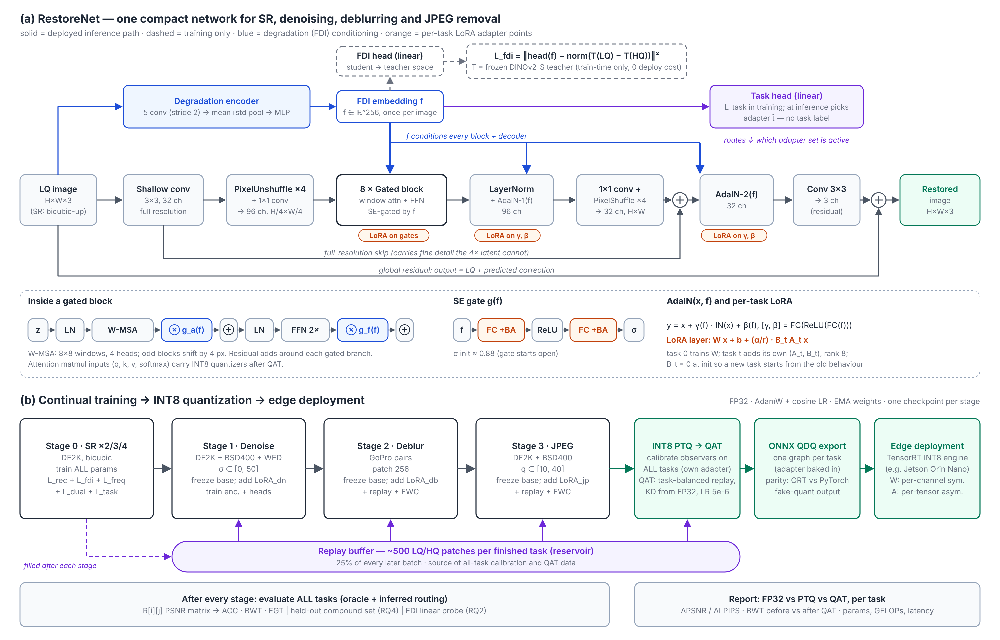

# Continual, Quantization-Aware All-in-One Restoration (OUR project)

One compact network, no pretrained generative backbone, that learns
**SR → denoising → deblurring → JPEG** one task at a time, then gets INT8 QAT.



## Layout

```
models/net.py        RestoreNet: degradation encoder (FDI) → 8 SE-gated window-attention blocks → AdaIN decoder
models/lora.py       per-task low-rank adapters (TaskLoRALinear) + switching helpers
models/teacher.py    train-time-only FDI teacher (DINOv2), not part of the deployed model
models/quant.py      INT8 fake-quant layers (per-channel W, per-tensor A, attention matmuls)
data/degrade.py      synthetic SR / noise / JPEG (and a toy blur) degradations
data/datasets.py     synthetic + paired datasets, per-task replay buffer
losses.py            Charbonnier, frequency self-distillation, FDI target normaliser
cl.py                stage-wise freezing + EWC
metrics.py           fixed PSNR/SSIM/LPIPS protocol + ACC/BWT/FGT  (verified against scikit-image)
train.py             runs all stages, evaluates every task after every stage → R matrix
evaluate.py          standalone eval; routing = oracle | inferred (task head) | ncm (prototypes) | soft (adapter mix)
experiments.py       generates + runs every baseline / ablation / task-order config over several seeds
eval_external.py     scores another method's output images with our protocol (FluxIR, VOSR, PromptIR, ...)
configs/external_baselines.yaml  registry of external methods: reference, code, how to compare, reported numbers
scripts/estimate_gpu_time.py     times real iterations on your GPU and extrapolates the whole study
aggregate.py         runs/*/results.json → mean ± std tables (Markdown + LaTeX booktabs)
qat.py               PTQ baseline → QAT → layer sensitivity sweep → ONNX QDQ export + parity
probe.py             RQ2: linear probe / nearest centroid on FDI embeddings, confusion matrix
profile_model.py     params, per-task adapter cost, GMACs/GFLOPs, size, latency
common.py            checkpoint loading (FP32 and QAT), patch collection
scripts/make_arch_diagram.py  regenerates docs/architecture.svg
scripts/prepare_gopro.py      flattens GoPro_Large so blur/sharp pairs match by filename
configs/smoke.yaml   2-minute CPU end-to-end test on toy data
configs/cl_adapters.yaml  real run
```

## Quick start

```bash
pip install -r requirements.txt
python scripts/make_toy_data.py --out toy_data
python train.py --config configs/smoke.yaml          # sanity check, numbers meaningless
python train.py --config configs/cl_adapters.yaml    # real run (needs datasets/ below)
python evaluate.py --config configs/cl_adapters.yaml --ckpt runs/cl_adapters/stage3.pt --routing inferred

# INT8
python qat.py --config configs/cl_adapters.yaml --sensitivity --export
python evaluate.py --config configs/cl_adapters.yaml --ckpt runs/cl_adapters/qat/qat.pt --qat

# full study: baselines + ablations + task orders, 3 seeds, then paper tables
python experiments.py --base configs/cl_adapters.yaml --suite all --seeds 0 1 2            # list configs
python experiments.py --base configs/cl_adapters.yaml --suite main --seeds 0 --scale 0.05 --run   # pilot first
python experiments.py --base configs/cl_adapters.yaml --suite all --seeds 0 1 2 --run --qat
python aggregate.py        # -> runs/tables.md, runs/tables.tex

# analysis
python probe.py --ckpt runs/cl_adapters/stage3.pt --hq_dir datasets/DIV2K/valid_HR
python profile_model.py --ckpt runs/cl_adapters/stage3.pt --onnx runs/cl_adapters/qat/model_sr_int8_qdq.onnx
```

Outputs go to `runs/<name>/`: one checkpoint per stage, plus `results.json` with the
R matrix (PSNR, task × stage), ACC/BWT/FGT, and oracle and inferred-routing results.

## Design decisions (worth stating in the report)

* **Same resolution for all tasks.** For SR, the LQ image is bicubic-upsampled to HR size,
  so one network and one output head cover every task.
* **FDI without a train/test mismatch.** The student encoder sees only LQ and is regressed
  onto the teacher difference T(LQ) − T(HQ), normalised by a running per-dimension RMS.
  Train and test therefore share one code path. The teacher is train-time only, so it
  adds nothing to deployed params or FLOPs.
* **Adapters.** Stage 0 trains everything. Each later stage freezes the base and adds
  LoRA pairs to the SE gates and AdaIN MLPs. With `lora_backbone: true`, adapters also go
  on attention and FFN; ablate both settings.
* **Degradation encoder input and init.** The encoder sees `[x, x − blur(x)]` and uses
  variance-preserving init plus LayerNorm on the pooled mean / log-std statistics. With
  default init and the raw image only, the embedding was nearly constant across inputs
  (std ≈ 1e-4) and task routing was at chance. Mention this in the method section.
* **Routing without a task label (RQ2).** There are three options: the learned task head
  (its CE is class-balanced across the current task and replayed tasks, which counters
  recency bias); nearest-class-mean prototypes rebuilt from the replay buffer after every
  stage (stored as buffers, so no learned parameters); and soft routing, which mixes the
  adapter deltas with the softmax of the task head. Soft routing is the natural setting for
  compound degradations (RQ4).
* **The shared degradation encoder stays trainable** so it can learn new degradation types.
  It is therefore the main source of forgetting, which replay and EWC are there to limit.
  To isolate it, ablate with `shared_trainable: ["task_head.*"]`.

## Experiments to run (configs differ only in `cl` and `stages`)

| Run | Setting |
|---|---|
All of these are generated by `experiments.py` (`--suite main | ablation | order | all`).

| Run | Setting |
|---|---|
| `specialist_*` | one-stage config per task (upper reference; Δ spec. column) |
| `joint` | `cl.mode: joint` (multi-task upper bound) |
| `finetune` | `cl.mode: finetune` (forgetting lower bound) |
| `er` / `ewc` / `mas` / `lwf` | finetune + replay / + EWC [7] / + MAS / + LwF output distillation |
| `adapters_only` | adapters without replay or EWC |
| `proposed` | adapters + replay + EWC (base config) |
| `abl_*` | replay size, EWC λ, LwF, `lora_backbone`, LoRA rank, frozen encoder, `teacher: none`, no freq / dual / task-CE |
| `order_*` | reversed and shuffled task orders, proposed vs finetune |
| `icvgip_sr` | our ICVGIP model [1] reproduced: BLIP-2 Q-Former FDI, no freq / dual loss, SR only (`--suite proposal`) |
| `icvgip_seq_finetune` | [1] trained naively on the task sequence |
| `icvgip_cl` → `icvgip_cl_dino` → `icvgip_cl_dino_freq` → `proposed` | cumulative component ladder: [1] + our CL, + DINOv2 [4], + frequency self-distillation [5], + dual input [6] |

### External methods ([2]–[6], all-in-one models, specialists)

The generative SR methods in the proposal cannot be retrained here: FluxIR (12B Flux),
DiffRes, VOSR, FRAMER and DNF-SR. Compare against them in one of two ways.

1. **Score their outputs with our protocol.** This is the preferred option: run the official
   code, use released results, or ask the authors for them.
   ```
   python eval_external.py --config configs/cl_adapters.yaml --method VOSR --outputs results_external/VOSR
   ```
   The layout is `<outputs>/<eval dataset name>/<image>.png`, matched to HQ by filename stem.
2. **Copy the paper's numbers** into `reported:` in `configs/external_baselines.yaml`.
   The table marks these with `*`, and the paper must say they come from the original
   papers' evaluation.

The registry records what was available in Oct 2026: VOSR had code; FluxIR, DiffRes, FRAMER
and DNF-SR had no released code. Check again before submission. The generative methods
report no-reference metrics on RealSR / DRealSR, so set
`nr_metrics: [musiq, maniqa, clipiqa, niqe]` in the config (needs `pip install pyiqa`) to
compare on their terms. Reviewers will also ask for the all-in-one models PromptIR, AirNet
and InstructIR. Retrain those with their official code on **our** training data, then score
them with `eval_external.py`. `aggregate.py` puts all of them in one table next to our
models (Table 6).

BLIP-2 ViT-g is a heavy teacher, about 100x the student's FLOPs. If the `icvgip_*` runs are
too slow, set `loss.fdi_max: 2` to compute the teacher on only 2 samples per batch, and use
the same value in every run you compare.

## Datasets (expected under `datasets/`)

| Path | Source |
|---|---|
| `DF2K/HR` | DIV2K train HR + Flickr2K HR merged |
| `BSD400`, `WED` | standard denoising training sets |
| `GoPro/{train,test}/{blur,sharp}` | GoPro_Large, flattened so filenames match |
| `benchmark/{Set5,Set14,BSD100,Urban100,Manga109}/{HR,LR_bicubic/X4}` | official MATLAB-bicubic LR files (do **not** regenerate with PIL) |
| `CBSD68`, `Kodak24`, `McMaster`, `LIVE1`, `Classic5` | clean images; noise / JPEG applied with fixed seeds |
| `SIDD`, `RealSR`, `DRealSR`, `HIDE`, `RealBlur` | add as `type: paired` entries |

## Evaluation protocol (metrics.py)

* SR and JPEG: Y channel (BT.601). SR crops `scale` pixels from the border.
* Denoising and deblurring: RGB, no crop.
* Outputs are quantised to uint8 before scoring.
* SSIM uses an 11×11 Gaussian window with σ = 1.5.

Before trusting any number, reproduce one published baseline with this script
(e.g. download released SwinIR outputs on Set5 ×4 and score them here).

## INT8 scheme (qat.py / models/quant.py)

* **Weights:** per-output-channel symmetric INT8, with scales recomputed every step.
* **Activations:** per-tensor asymmetric uint8 with EMA min/max observers. The observers
  are calibrated on replay patches from **all** tasks, each passed through its own adapter,
  and are frozen after `observer_warmup` steps.
* **What gets quantized:** the inputs and weights of every conv and linear layer, the
  per-task adapter intermediates, and the q, k, v and softmax inputs to the attention
  matmuls.
* **What stays in floating point:** the layers in `keep_fp` (first and last conv by
  default), the norms, the activations and the elementwise ops. Report these in the paper.
  `results.json` lists them along with the INT8 weight coverage.
* **QAT recipe:** task-balanced batches, Charbonnier loss plus L1 distillation from the
  frozen FP32 model, LR 5e-6 with a cosine schedule.
* **Export:** one ONNX graph per task containing QDQ nodes. The script checks that ONNX
  Runtime output matches the PyTorch fake-quant output. Build the real engine on the
  device with `trtexec --onnx=model_sr_int8_qdq.onnx --int8`.

## Not done yet

* QAT after every stage (the secondary RQ3 setting). The current `qat.py` quantizes once
  at the end.
* Real CCTV frames (no-reference metrics only).
* NR metrics are wired in (`nr_metrics`) but untested in this repo's sandbox: pyiqa
  downloads its weights on first use.
* Real-blur probe data. The synthetic deblur class is now a 50/50 mix of random
  camera-shake motion kernels and Gaussian blur (`data/degrade.py`). For the paper, also
  probe with GoPro blur frames.
